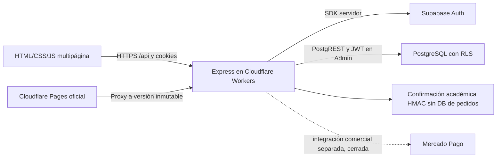
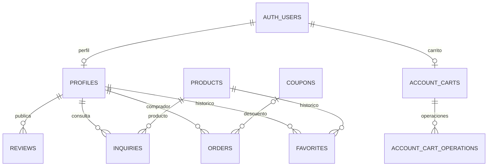

# Arquitectura, datos y API de DREAMS

Estado auditado: 13 de octubre de 2026. Para versiones desplegadas y evidencia consultar `CURRENT_STATE.md` y `rubric_validation.md`. Los documentos históricos no reemplazan el código actual.

## Arquitectura real

`public/` contiene ocho pantallas públicas, estilos, imágenes y controladores vanilla. `views/admin.html` es privado. `server/app.js` construye contexto por instancia y registra etapas de middleware/rutas en orden. No hay seed al arrancar. `worker/index.mjs` adapta Express a `workerd`/node:http y sirve Static Assets. `pages/proxy.mjs` conserva cookies/Origin/cuerpo, redirects manuales, cabeceras y caché privada; el destino oficial se fija en `pages/official-release.json`.

Frontend: sólo consume `/api` del mismo origen. Servidor: SDK Supabase consume Auth y Data API del proyecto `nwsmbemwtexmrtpkgxrz`; adapta columna DB `marca` al contrato HTTP `brand`. No hay SDK privilegiado en navegador. WhatsApp es un enlace `wa.me` con resumen, no una API consumida. Google está preparado con PKCE pero deshabilitado hasta configuración/verificación.

El carrito de esta base es selección visitante en localStorage, reconciliada mediante cotización del servidor. Persistencia por cuenta es PR45 independiente, no integrada ni acreditada remotamente. Checkout académico: UUID criptográfico por intento, snapshot firmado con dueño/vencimiento, reintentos conservan referencia, envío cero. No crea orders, no cambia stock, no llama a pasarela y no registra un pago comercial aprobado. Los campos de tarjeta no se leen ni transmiten. Demo comercial histórico y Mercado Pago son integraciones distintas, protegidas por flags/esquema/credenciales.

## Diseño de base de datos verificado

SELECT de catálogo PostgreSQL confirmó **nueve tablas públicas con RLS activa**, 46 productos, ocho perfiles y cero pedidos al revisar. No se consultaron hashes ni secretos, ni se hicieron escrituras.

| Tabla | Clave / relaciones | Función y permiso relevante |
|---|---|---|
| `profiles` | `id` UUID → `auth.users` | Nombre y role customer/admin; lectura propia/Admin; autoridad server-side |
| `products` | `id` bigint | `marca`, nombre, notas, género/categoría, tamaño/precio/stock/imagen; lectura pública; mutaciones Admin |
| `reviews` | `id`; `user_id` → profiles | Opiniones; lectura pública, publicación autenticada por servidor, edición/eliminación Admin |
| `inquiries` | `id`; `user_id` → profiles, `product_id` → products | Consultas; sin escritura pública Data API; API servidor limitada y Admin lectura |
| `coupons` | `id` bigint | Código/porcentaje/estado/condiciones; política Admin; descuento calculado en servidor comercial |
| `orders` | `id` UUID; user → profiles, coupon → coupons | Snapshot comercial, proveedor/estado/importes/items; lectura por API autorizada; no usado por confirmación académica |
| `favorites` | (user_id,product_id) → profiles/products | Histórico protegido por propietario; sin UI/API actual, no se borra |
| `account_carts` | user_id → auth.users | Estructura de PR45, lectura por propietario; integración inactiva en esta base |
| `account_cart_operations` | (user_id,operation_id); user → account_carts | Idempotencia de PR45; sin acceso público/integración activa aquí |

`supabase/migrations/` es historial versionado, no un comando para ejecutar durante QA. `supabase/schema.sql` es snapshot legacy y no coincide completamente con la DB real. No restablecer ni aplicar seeds. Admin usa JWT/RLS y origen exacto; `user_metadata` no autoriza. Grants heredados y concurrencia de edición requieren revisión separada; no alterar permisos para ocultar fallos.

Imágenes: `products.image_url` persiste un enlace; no hay upload/Storage en esta implementación. Admin valida sintaxis y decodificación nativa, acepta URLs HTTPS sin extensión, avisa sobre enlaces firmados conocidos, invalida comprobaciones viejas y conserva URL en edición de otros campos. Servidor no descarga URLs arbitrarias (sin SSRF/HEAD). Cinco enlaces reales con fallback siguen pendientes, sin reemplazos masivos.

## API propia y documentación pública de la API externa

[Referencia del SDK Supabase JavaScript](https://supabase.com/docs/reference/javascript/introduction), [Data API/PostgREST](https://supabase.com/docs/guides/api), [Auth con contraseñas](https://supabase.com/docs/guides/auth/passwords), [seguridad del hash](https://supabase.com/docs/guides/auth/password-security), [RLS](https://supabase.com/docs/guides/database/postgres/row-level-security).

Según confirmación del usuario, el profesor acepta el consumo externo desde servidor. Esto no convierte funcionalidades pendientes en operativas.

| API DREAMS | Uso |
|---|---|
| `GET /api/products`, `/api/products/:id`, `/api/brands` | Catálogo/detalle/marcas; filtros search, brand, gender, category, max_price, sort; home limit8 |
| `GET /api/config`, `/api/health`, `/api/checkout/config` | Contactos/configuración pública/readiness/habilitación real |
| `POST /api/auth/login`, `/register`, `/logout`; `GET /api/auth/me` | Supabase Auth, sesión HttpOnly y perfil público sin contraseñas |
| `/api/auth/google`, `/callback`, `/config` | PKCE preparado; proveedor/flag siguen pendientes |
| `GET/POST /api/reviews`, `POST /api/inquiries` | Opiniones/consultas con validación, rate limit y sesión cuando corresponde |
| `POST /api/cart/quote` | IDs/cantidades/precios/stock autoritativos, resumen WhatsApp, envío académico cero |
| `POST /api/presentation/session`, `/payment`, `/result` | Ticket/confirmación académica firmada sin datos de tarjeta ni pedidos comerciales |
| `/api/checkout/session`, `/demo-payment`, `/confirm`; `/api/payments/webhook`; `/api/orders/:id` | Flujo comercial independiente; no habilitado ni cobrado durante esta revisión |
| `POST /api/coupons/validate` | Cupón comercial normalizado y calculado servidor |
| `/api/admin/stats`, `/products`, `/users`, `/inquiries`, `/reviews`, `/orders`, `/coupons` | Admin con rol servidor/JWT/RLS; productos/reviews/cupones CRUD existente |

La búsqueda pública puede incluir familia; la búsqueda Admin nueva filtra **sólo nombre o marca**, parcial, sin case/tildes/espacios exteriores. No interpola la consulta como HTML ni SQL. Sin paginación en la lista Admin actual: se filtra todo el catálogo cargado, manteniendo orden/acciones.

## Ejecución y verificación

Node24/Corepack/pnpm11.19.0. Instalar con `corepack pnpm install --frozen-lockfile`. Sin una DB aislada y configuración segura, ejecutar la suite con fixtures: `corepack pnpm run check`, `corepack pnpm test`, `corepack pnpm run build:cloudflare`, `corepack pnpm run build:pages`, `corepack pnpm audit --prod`.

`check` valida sintaxis y límites AST; no existe un lint/typecheck independiente ni TypeScript en este proyecto. Builds generan artefactos, **no publican**. `corepack pnpm start` escucha por defecto en puerto8080 y necesita SUPABASE_URL/SECRET en gestor seguro de un entorno autorizado. No usar una clave de producción en tests locales. No ejecutar `seed.js`, resets ni migraciones para arrancar.

Publicación autorizada de esta revisión: sólo Worker preview aislado; flags read-only true, schema-ready false, auto-confirm false, Google false; firma académica propia. Secrets permanecen Cloudflare/server. Pages oficial y su versión inmutable no se modifican. Procedimientos detallados de hosting están en `cloudflare_migration.md` y `pages_frontdoor.md`.
