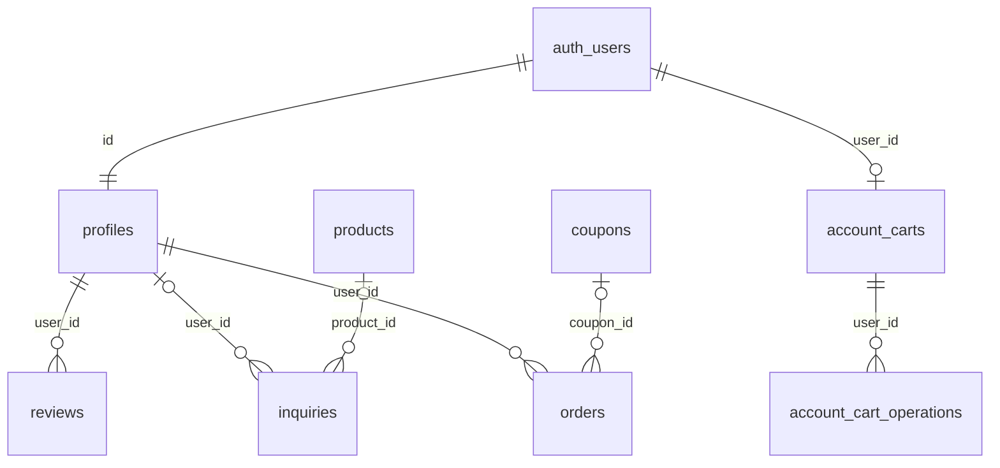

# Base de datos real e histórico

Motor real: **PostgreSQL en Supabase**, proyecto `nwsmbemwtexmrtpkgxrz`. Auth es un servicio del proveedor, no una tabla de contraseñas propia. La excepción docente para usar Supabase, confirmada por el usuario, está en [sqlite.md](sqlite.md). No se incluyen datos personales, hashes de contraseñas ni filas de clientes.

El 29/10/2026 se consultó sólo `information_schema.columns` mediante la integración autorizada. [Metadatos de columnas reales](esquema-columnas-real.json) contiene nombres, tipos y nulabilidad, sin filas de negocio. Las relaciones y permisos siguientes se contrastan con las migraciones versionadas; esta lectura no certifica por sí sola todos los grants remotos actuales. No hubo DDL ni escritura de datos.

[Fuente Mermaid completa](base-de-datos.mmd). Las flechas representan claves foráneas declaradas; `account_carts.items` y `orders.items` son JSON y no claves foráneas a cada producto.

| Tabla | Clave y campos principales | Uso y restricciones |
|---|---|---|
| `auth.users` | UUID gestionado por proveedor | Registro/login normal; no exportar datos ni modificar credenciales. |
| `profiles` | PK/FK `id`, `name`, `role`, `created_at` | customer/admin, perfil derivado de Auth. Nunca aceptar rol solicitado por navegador. |
| `products` | PK bigint `id`, **`marca`**, name, gender, category, size_ml, price, stock, intensity, family, top/heart/base_notes, description, image_url, featured, timestamps | API devuelve `brand`; el adaptador traduce `marca` real. Precio/stock/tamaño e intensidad validados. |
| `reviews` | PK bigint; FK nullable user_id; user_name, rating 1–5, comment, created_at, operation_id UUID nullable | Autoría verificada en servidor, borrado propio y moderación Admin. operation_id aporta deduplicación. |
| `inquiries` | PK bigint; FK nullable user_id/product_id; snapshots product_name/user_name/user_email, created_at | Acceso Admin; información personal, nunca parte del ZIP. |
| `coupons` | PK bigint; code, discount_percent, active, expires_at, max_uses, per_user_limit, minimum_purchase, conditions, timestamps | Admin UI administra código, porcentaje y activo. Otros campos reales no tienen edición completa en UI. |
| `orders` | PK UUID; FK user_id/coupon_id; provider, referencias proveedor, status/detail, currency, subtotal/discount/total, snapshots cupón/items, paid_at, timestamps | Historial comercial/legacy. Simulación académica usa tickets firmados, no inserta aquí. |
| `account_carts` | PK/FK UUID user_id; items JSONB, revision, updated_at | Aislamiento por UUID, cantidades canónicas del servidor, máximo 30 entradas. |
| `account_cart_operations` | PK compuesta user_id/operation_id; operation JSONB, created_at | Operaciones idempotentes y comparación de repetición. |
| `favorites` | PK user_id/product_id, FKs, created_at | Histórico conservado; función retirada del sitio. No presentarla como activa. |

Permisos previstos en migraciones: RLS en tablas públicas; catálogo/opiniones públicos de lectura; perfil propio y lectura del carrito por dueño; writes administrativos mediante JWT y políticas de Admin. RPC `dreams_cart_operation` es `SECURITY INVOKER`, ejecución sólo service_role y el backend vincula UUID a sesión verificada. El servidor conserva la clave privilegiada; el navegador sólo usa `/api`.

## Reproducir estructura sin datos privados

1. Crear un proyecto de desarrollo vacío controlado, sin conectar producción.
2. Revisar y aplicar en orden los SQL de [supabase/migrations](../../supabase/migrations), mediante Supabase CLI o SQL editor de ese proyecto. Conservar historial y ejecutar advisors después. No ejecutar `db reset` sobre remoto ni seeds.
3. Las migraciones históricas de catálogo usan `brand`; el proyecto real heredado usa `marca`. Node detecta ambos mediante `server/product-schema.js`; el Worker oficial está fijado a `marca` para el proyecto esperado. No reutilizar sin adaptar esa configuración en un proyecto nuevo. Esta diferencia está documentada, no se oculta como dump idéntico de producción.
4. Verificar tablas, grants, RLS y operaciones con cuentas de desarrollo. Crear datos sintéticos manualmente por el flujo normal/Admin, sin exportar clientes ni promover cuentas desde el navegador.

`supabase/schema.sql` es un esquema histórico, no la fuente canónica completa actual. El esquema real de columnas y las migraciones posteriores tienen prioridad. La reproducción conectada en proyecto nuevo no fue ejecutada en esta tanda y figura pendiente en la matriz.
