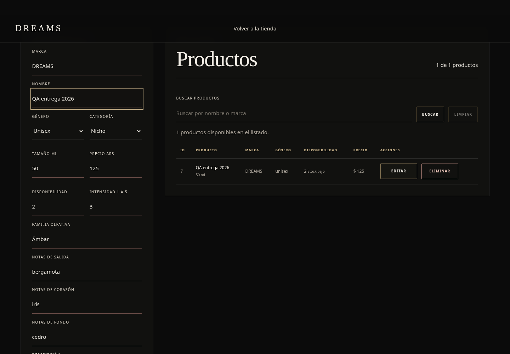

# Manual de uso DREAMS · Entrega 2026

**Versión documentada: candidato de PR #56.** Oficial autorizada: https://dreams-perfumes.pages.dev/. La oficial sigue restaurada; registro/login/Admin del candidato todavía no tienen QA remota acreditada. Las capturas de esta edición son del candidato local con datos sintéticos, etiquetadas como tales; no representan una sesión Admin productiva ni una publicación final.

## Inicio, catálogo y detalle

Abrir Inicio y usar el menú para entrar a Perfumes, colecciones Mujer/Hombre/Unisex, Nosotros, Cuenta y Carrito. En móvil, desplegar el menú; con teclado usar Tab y Enter. La portada es una imagen estática. El carrusel de colecciones se mueve con Anterior/Siguiente o flechas cuando el foco está en esos controles; no avanza solo. Sin JavaScript conserva las tres opciones visibles.

En catálogo, escribir nombre o marca y aplicar la búsqueda. Combinar filtros disponibles de marca, género, tipo y precio, y ordenar por los criterios del selector. Limpiar filtros para volver a todo el catálogo. Abrir una tarjeta para ver imagen, tamaño, precio, stock, intensidad y notas. Una imagen rota muestra un fallback; no prueba que se haya perdido su URL en base.

## Crear cuenta, iniciar y cerrar sesión

En Cuenta elegir Registro, completar nombre, correo, contraseña y repetición. Respetar las validaciones del formulario; no usar credenciales reutilizadas. En la configuración solicitada no se requiere confirmación de correo, pero la aplicación sólo anuncia sesión activa si el proveedor realmente la devuelve. No volver a registrar repetidamente una cuenta si la respuesta se interrumpe: probar login o revisar el mensaje.

Para login, completar correo y contraseña. Si son incorrectos, corregirlos sin revelar la contraseña. Recargar o navegar debe conservar la sesión mediante cookies; si vence se intenta renovar. Cerrar sesión desde Cuenta y comprobar que ya no aparecen los datos personales ni el acceso Admin. Si la red falla al salir, reintentar y comprobar el estado antes de usar un equipo compartido.

Los botones se bloquean durante envío para evitar duplicación; los mensajes indican errores de formato, acceso o conexión. Ante fallo de red, conservar los datos, revisar conectividad y reintentar una sola vez después de comprobar si se completó la operación. Un customer y un visitante no pueden entrar al Admin. No se debe editar localStorage para elevar permisos.

## Carrito por cuenta y checkout académico

Agregar productos disponibles desde catálogo o detalle; abrir Carrito para aumentar/reducir cantidades, quitar o vaciar. El servidor recalcula precio y disponibilidad. En visitante se conserva el carrito local; al entrar, el candidato combina con el de la cuenta sin sumar duplicados por repetir la misma operación. Cambiar a otra cuenta debe mostrar su propio carrito, nunca el de la anterior. Si queda una operación pendiente, esperar la sincronización antes de comprar.

Comprar abre el checkout académico: revisar resumen, total y envío gratis de esa simulación; completar sólo datos ficticios de tarjeta válidos para el formulario (por ejemplo la tarjeta de prueba 4242 4242 4242 4242, vencimiento futuro y CVV ficticio). Nunca ingresar una tarjeta real. Los campos se validan en navegador; sólo el ticket firmado viaja al backend. Continuar una sola vez, esperar el resultado y conservar la referencia estable. Si se recarga durante una espera, el intento se retoma sin crear un segundo resultado para el mismo ticket. El flujo no cobra dinero, crea pedidos comerciales ni descuenta stock.

No confundir los módulos históricos Mercado Pago/demo con la simulación académica de la oficial: no habilitar pagos comerciales para demostrar este manual.

## WhatsApp y opiniones

En detalle o carrito, WhatsApp abre el destinatario y el resumen preparado. Revisar producto, cantidades, precio y total antes de decidir enviar. Esta integración no envía mensajes automáticamente. Las verificaciones del proyecto sólo abren/inspeccionan el enlace.

Para publicar una opinión, iniciar sesión y volver a Inicio. Elegir puntuación 1–5, comentario y publicar. La opinión queda asociada al usuario verificado. El botón Eliminar propio pide confirmación; no se permite borrar una opinión ajena mediante API aunque se modifique el navegador. Si el servidor o la red fallan, revisar la lista antes de repetir la publicación. Admin conserva moderación de edición/borrado.

## Entrar al panel Admin

Usar la cuenta administradora ya existente. Entrar desde Cuenta o `/admin`; el servidor valida el rol. Este manual no contiene contraseñas y no crea administradores. Si aparece acceso reservado, comprobar que la sesión pertenece a la cuenta autorizada; no cambiar roles ni contraseñas para sortearlo.

El panel tiene tarjetas de Productos, Usuarios, Consultas, Opiniones, Pedidos, Disponibilidad baja y Cupones. Una tarjeta activa muestra su módulo; los conteos provienen del servidor. Si falla la carga, usar Reintentar. Con teclado, Tab enfoca la tarjeta y Enter/Espacio la activa.

## Productos e imágenes: alta, edición y guardado

En Productos, buscar por nombre o marca con Buscar/Enter. Limpiar restablece el listado. Disponibilidad baja incluye **0, 1 o 2 unidades**; un valor desconocido no se inventa como cero.

Para alta, completar marca, nombre, género, tipo, tamaño en ml, precio, stock, intensidad, familia, notas, descripción e imagen. Precio y stock no pueden ser negativos; stock y tamaño deben ser enteros válidos. Destacar en Inicio controla la selección destacada, no garantiza un orden promocional inventado.

Usar una URL HTTPS directa a imagen o un asset local permitido. No pegar una página de búsqueda, credenciales en URL o enlace HTTP. La vista previa comprueba la imagen y bloquea Guardar si falta, falla o todavía está pendiente. Un enlace temporal firmado puede vencer y muestra aviso: preferir URL permanente. Tras un error, corregir el enlace y Reintentar; la respuesta atrasada de una imagen anterior no debe validar la nueva.

Editar carga el producto existente, incluida su URL. Cambiar otro campo conserva esa imagen. Cancelar/Limpiar permite salir de la edición con aviso de cambios sin guardar. Editar y Eliminar conservan las mismas dimensiones. Eliminar es permanente y pide confirmación; para practicar sólo usar productos exclusivos de prueba.

Guardar espera la escritura y una lectura posterior que confirme todos los campos. Si esa lectura falla, el formulario conserva los datos y no anuncia éxito: revisar el listado antes de repetir un alta. Después de confirmar, recargar y comprobar Admin, catálogo, detalle y conteos. La persistencia remota de esta versión está pendiente de sesión y conexión válidas; no basta la captura local.

## Otros módulos Admin

- **Pedidos:** listar y revisar referencia, fecha, estado y totales existentes. No generar una compra comercial para poblarlo. La simulación académica no crea filas aquí.
- **Cupones:** crear/editar código, porcentaje y activo, guardar o limpiar; el código se normaliza en mayúsculas. No se presenta un cupón comercial como activo en el checkout académico.
- **Usuarios:** lectura de perfiles y roles; esta UI no permite crear Admin ni cambiar contraseñas/roles.
- **Consultas:** lectura de consultas existentes y producto asociado, sin enviar WhatsApp automáticamente.
- **Opiniones:** buscar, editar puntuación/comentario o eliminar con confirmación. No hay ocultamiento/publicación por estado en el modelo y no se simula.

## Errores y recuperación

Un 401 indica sesión/credencial no válida; un 403 indica operación no autorizada; un 503 puede indicar dependencia no disponible. No pegar valores de claves ni headers en capturas. Si el catálogo funciona pero el registro falla, no dar por sana toda la aplicación. Ante fallo de imagen revisar URL, permisos y disponibilidad del hosting de la foto; ante guardado dudoso revisar listado antes de repetir.

El operador conserva rollback del frontend restaurado y mantiene el backend candidato aislado hasta verificarlo. Los usuarios no tienen que reconfigurar Supabase ni Cloudflare. Los requisitos técnicos pendientes están documentados en la matriz; no se ocultan con el manual.
