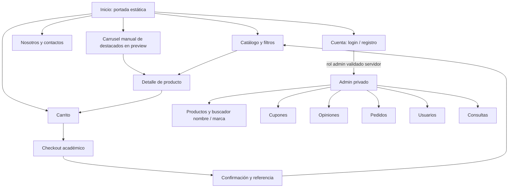

# Mapa de navegación y wireframes

| Pantalla | Orden visual y controles |
|---|---|
| Inicio | Header/nav/carrito → hero estático con CTA → Más buscados y carrusel manual → Nosotros → opiniones/acceso → footer compartido |
| Catálogo | Título/colección → búsqueda/filtros/orden/limpiar → conteo/loading/error/retry/empty → grilla → footer |
| Producto | Imagen y descripción → marca/nombre/precio → intensidad/stock → agregar/WhatsApp → notas → recientes → footer |
| Carrito | Filas: imagen/nombre/precio/cantidad/eliminar → resumen productos/envío gratis/total → Comprar/WhatsApp/retry/vaciar |
| Cuenta | Marca limpia → título → tabs login/registro → controles con labels → estado; con sesión: usuario/cerrar sesión/Admin si autorizado |
| Checkout | Productos/resumen → datos comprador/Tarjeta → Continuar/procesando → resultado con referencia/productos/envío gratis/total |
| Admin | Header/cerrar sesión → estadísticas/tabs → Productos formulario+preview imagen+estado → buscador/limpiar/listado/editar/eliminar; otras pestañas conservadas |

Escritorio: carrusel muestra varias tarjetas, composición editorial y grillas existentes. Móvil: menú desplegable accesible, controles táctiles, carrusel deslizante, formularios apilados, tablas en contenedor horizontal sin desbordar página. No existe UI de favoritos; se conserva sólo redirección histórica. No bloquear scroll ni navegación con fullscreen.
